# UTS PEMROGRAMAN WEB — Cendekia Bookstore

- **Nama :** Aidi Syahdan Firdaus
- **NIM :** 312510089
- **Kelas :** I251A
- **Prodi :** Teknik Informatika, Fakultas Teknik, Universitas Pelita Bangsa

Aplikasi web sederhana untuk memesan buku kuliah. Semua data diambil dari variabel JavaScript pada file `js/data.js` yang sudah disediakan dosen, jadi tidak pakai server atau database. Isi README ini langkah-langkah pembuatannya, dari menyiapkan file sampai uji coba tiap halaman, lengkap dengan screenshot kode dan hasil di browser.

---

## Pertama siapkan dulu bahan-bahan

- Buat folder bernama `uts pemrograman web`
- Buat lima halaman di dalamnya: `index.html`, `dashboard.html`, `stok.html`, `checkout.html`, `tracking.html`, ditambah `login.html` sebagai pengalih ke halaman login
- Buat folder `css` untuk `style.css`, folder `js` untuk `data.js` dan `script.js`, folder `assets` untuk logo, dan folder `img` untuk sampul buku
- Taruh file `data.js` dari dosen ke dalam folder `js`
- Hubungkan file CSS dan JavaScript di setiap halaman dengan tag `<link>` dan `<script>`
- Terakhir buka `index.html` di browser


Kode untuk menghubungkan CSS dan JavaScript ada di bagian `<head>`:

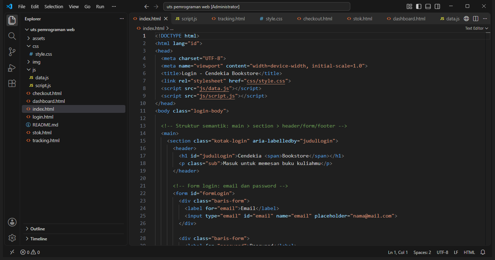

`data.js` sengaja ditaruh sebelum `script.js`. Isi `data.js` itu variabel `dataPengguna`, `dataKatalogBuku`, dan `dataTracking`. Kalau urutannya kebalik, `script.js` sudah jalan duluan padahal variabelnya belum ada, jadi browser langsung kasih error. Sama seperti percobaan di modul 6 waktu script dipindah ke head tanpa `defer`: kode jalan sebelum HTML selesai dibaca. Supaya aman, semua kode di `script.js` saya bungkus di dalam `DOMContentLoaded`, jadi baru dijalankan setelah semua elemen HTML siap.

---

## Langkah-Langkah Praktikum

### 1. Halaman login: struktur semantik dan form

**index.html**

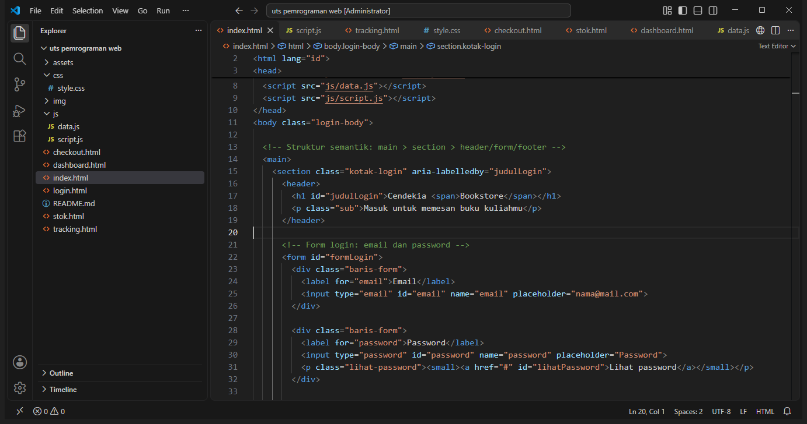

**Hasil di browser**

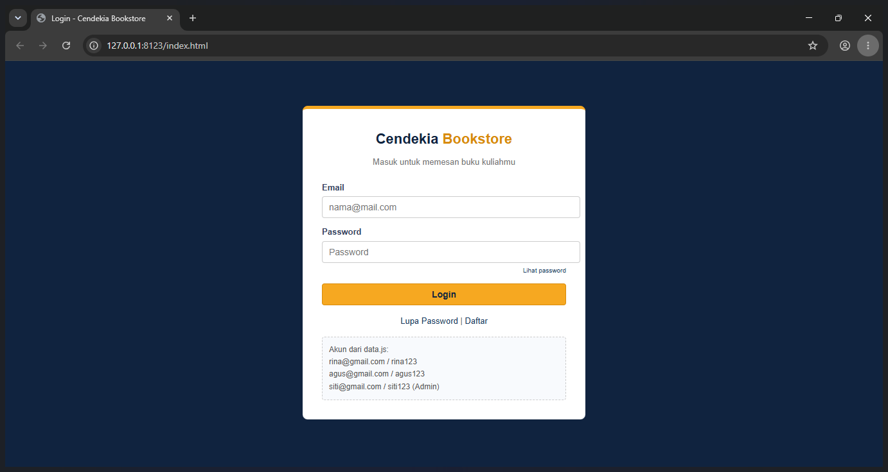

Halaman login saya susun pakai tag semantik: `<main>` membungkus satu `<section class="kotak-login">`, di dalamnya ada `<header>` untuk judul, `<form>` untuk kolom isian, dan `<footer>` untuk tautan Lupa Password dan Daftar. Tujuannya biar struktur halamannya jelas, bukan cuma tumpukan `<div>`.

Setiap kolom isian punya `<label for="...">` yang id-nya sama dengan id input, jadi waktu labelnya diklik, kursor langsung pindah ke kolomnya. Tombol Login pakai `type="submit"` supaya bisa ditekan lewat tombol Enter juga, bukan cuma klik.

### 2. Validasi login dan alert

**js/script.js**

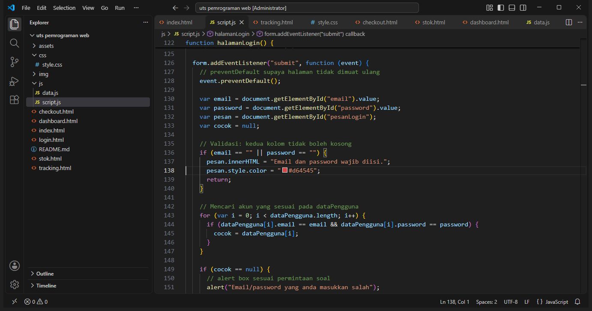

**Hasil di browser kalau email atau password salah**

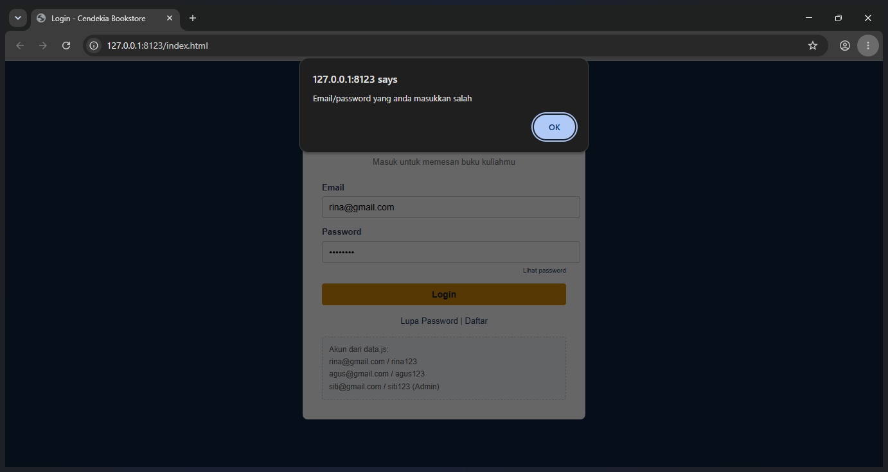

Alurnya begini: form diambil pakai `getElementById`, lalu dipasang `addEventListener("submit")`. Di dalamnya ada `event.preventDefault()` supaya halaman tidak dimuat ulang waktu tombol Login ditekan. Kalau tanpa itu, halaman langsung refresh dan pesan errornya hilang sebelum sempat kebaca.

Validasinya dua lapis. Pertama cek kolom kosong, kalau kosong muncul pesan merah di bawah form. Kedua, email dan password dicocokkan ke `dataPengguna` pakai perulangan `for`. Kalau tidak ada yang cocok, muncul `alert("Email/password yang anda masukkan salah")` sesuai permintaan soal, lalu kolom password dikosongkan lagi biar pengguna tidak perlu hapus manual. Kalau cocok, nama pengguna disimpan dan halaman pindah ke `dashboard.html`.

### 3. Data buku dari dosen

**js/data.js**

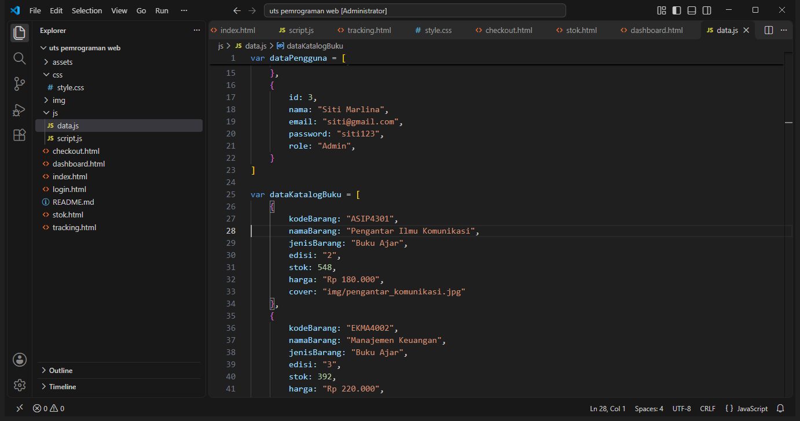

File ini tidak saya ubah sama sekali, saya pakai apa adanya. Isinya tiga variabel: `dataPengguna` (3 akun), `dataKatalogBuku` (5 buku), dan `dataTracking` (2 nomor Delivery Order). Yang perlu diperhatikan, `harga` di data bentuknya teks `"Rp 180.000"`, bukan angka. Jadi waktu mau dihitung, saya bikin fungsi `ambilAngka()` yang menyaring karakter angka satu per satu lalu diubah pakai `Number()`. Kalau langsung dijumlahin, hasilnya bakal `NaN`.

`dataTracking` bentuknya objek, bukan array, karena kuncinya nomor DO. Makanya waktu dibaca saya pakai perulangan `for-in`, bukan `for` biasa dengan index angka.

### 4. Dashboard: sapaan, jam, dan menu

**js/script.js**

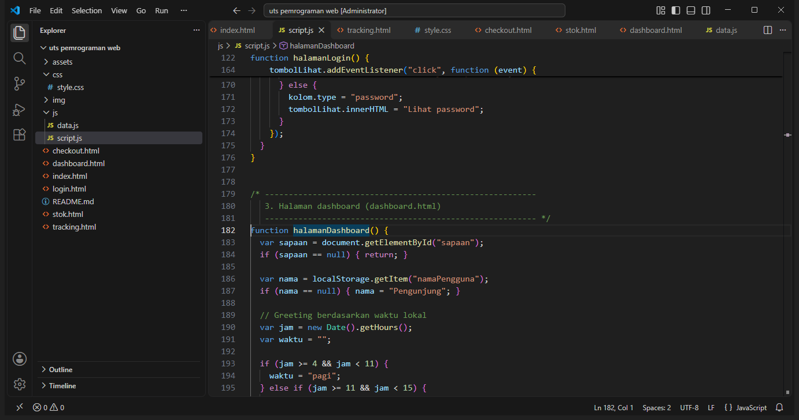

**dashboard.html**

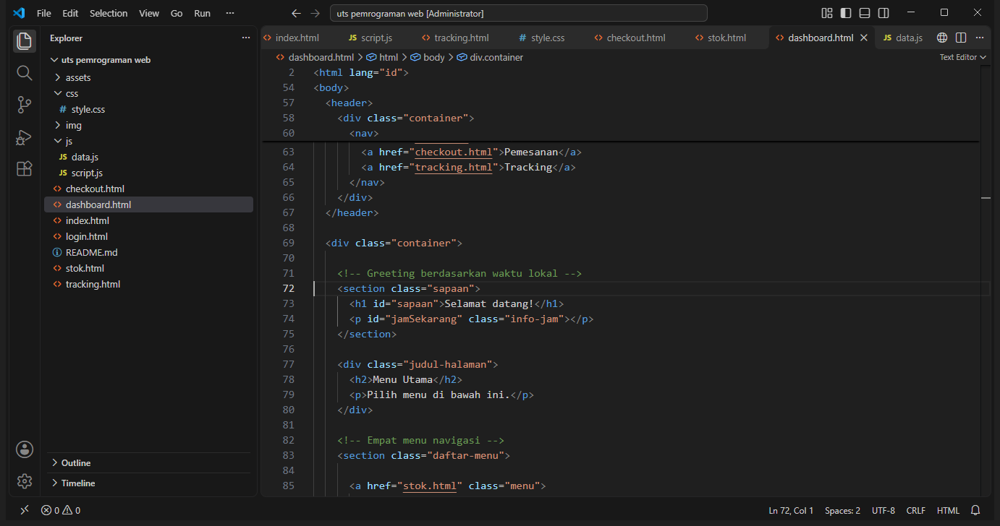

**Hasil di browser**

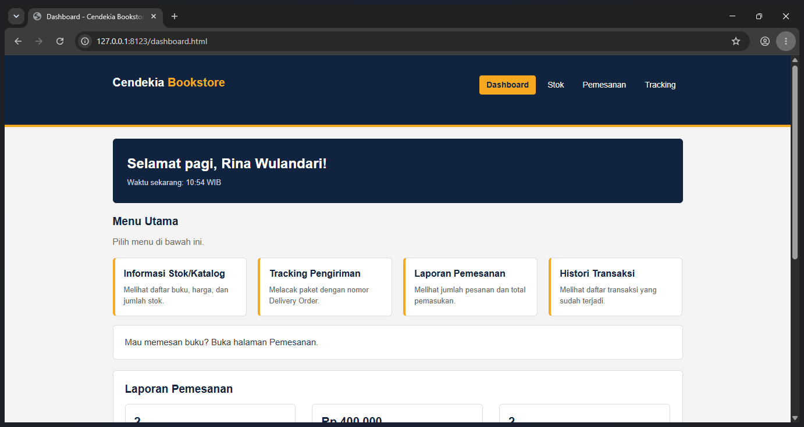

Sapaan diambil dari nama yang disimpan waktu login. Kalau belum login, nilainya `null`, jadi saya kasih nama cadangan "Pengunjung" biar tidak muncul tulisan "Selamat pagi, null!". Bagian waktunya pakai `new Date().getHours()` lalu dicek pakai `if-else`: 4–11 pagi, 11–15 siang, 15–19 sore, sisanya malam. Jadi tulisannya menyesuaikan jam laptop waktu dibuka.

Di bawahnya ada empat menu dalam satu baris. Caranya pakai `float: left` dengan lebar 23,5% dan `box-sizing: border-box`, lalu pembungkusnya dikasih `overflow: hidden` supaya tinggi kotaknya ikut menyesuaikan isi.

**Hasil di browser bagian laporan dan histori**

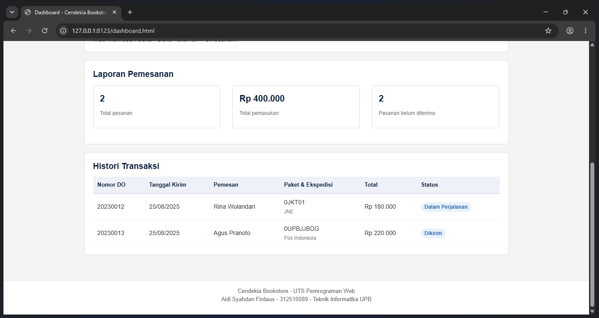

Angka di laporan dihitung dari data, bukan ditulis manual. Total pesanan dan total pemasukan dijumlahin lewat perulangan dari `dataTracking` ditambah pesanan baru, lalu isi tabel histori dibangun baris per baris pakai `createElement` dan `appendChild`.

### 5. Halaman stok: tabel dari data, pencarian, dan tambah buku

**stok.html**

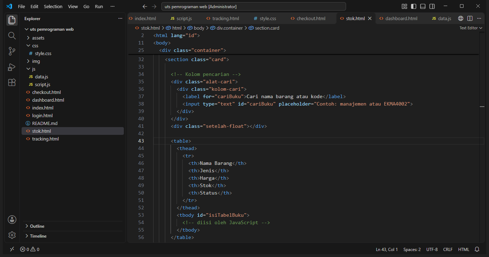

**js/script.js**

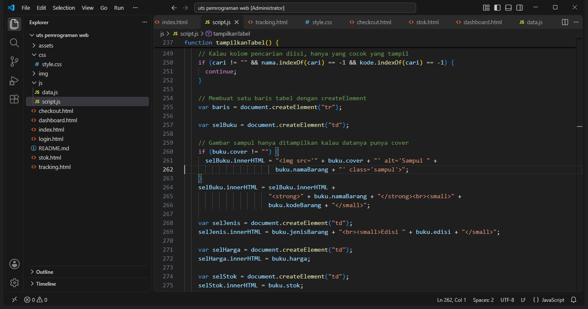

**Hasil di browser**

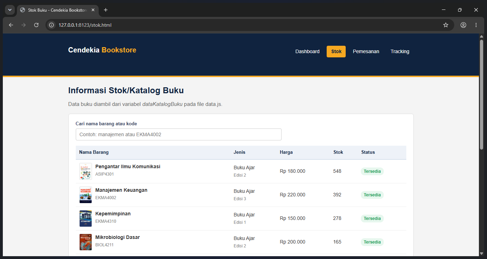

Tabelnya kosong di HTML, isinya baru dibuat JavaScript. Saya bikin `<tbody id="isiTabelBuku">` lalu diisi lewat perulangan `dataKatalogBuku`. Tiap baris dibuat dengan `document.createElement("tr")`, diisi lima `<td>`, baru ditempel pakai `appendChild`. Sampul buku ikut ditampilkan karena di data ada field `cover` yang menunjuk ke folder `img`. Statusnya otomatis: stok 0 jadi "Habis" merah, stok 50 ke bawah "Menipis" kuning, sisanya "Tersedia" hijau.

**Hasil pencarian dengan kata "ekma"**

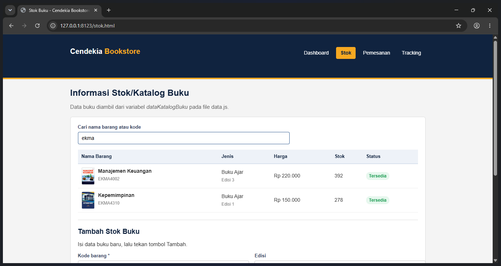

Pencarian jalan tanpa tombol, cukup ngetik langsung tersaring. Event yang dipakai `keyup`, jadi setiap kali tombol keyboard dilepas, tabel digambar ulang. Filternya cek nama barang atau kode barang pakai `indexOf()`, kalau tidak ketemu barisnya di-`continue` alias dilewati.

**Hasil setelah menambah buku baru**

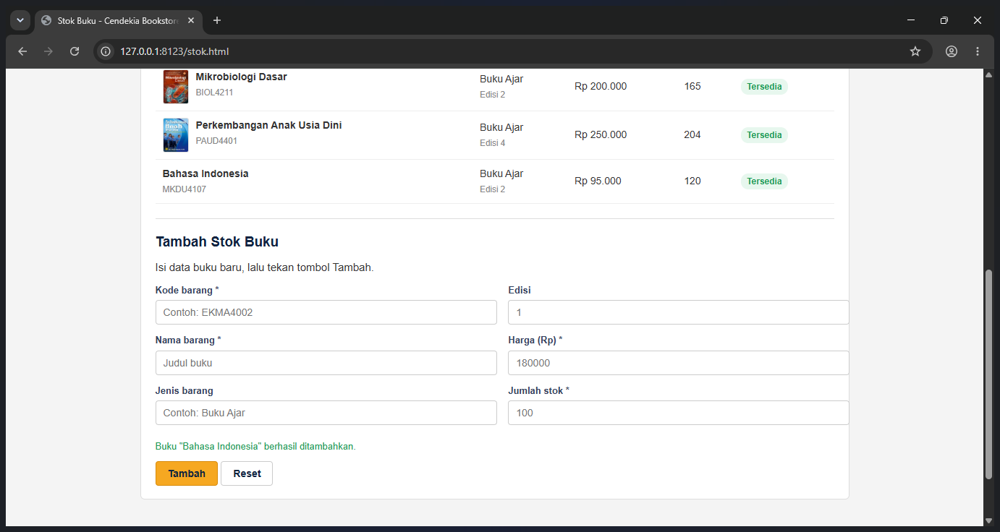

Form tambah buku divalidasi dulu sebelum datanya masuk: kolom bertanda bintang wajib diisi, nama minimal 3 karakter, harga harus lebih dari 0, dan stok tidak boleh negatif. Kalau lolos, objek buku baru dibuat dengan nama field yang sama seperti di `data.js` (`kodeBarang`, `namaBarang`, `jenisBarang`, `edisi`, `stok`, `harga`, `cover`), lalu dimasukkan ke array dan tabelnya digambar ulang. Form langsung dikosongkan dan muncul pesan hijau.

### 6. Halaman pemesanan: keranjang, ongkir, dan nomor DO

**checkout.html**

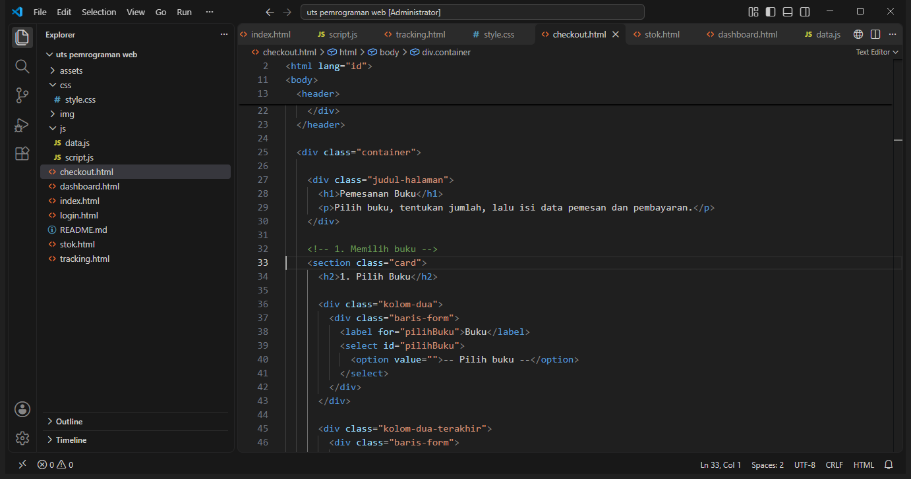

**js/script.js**

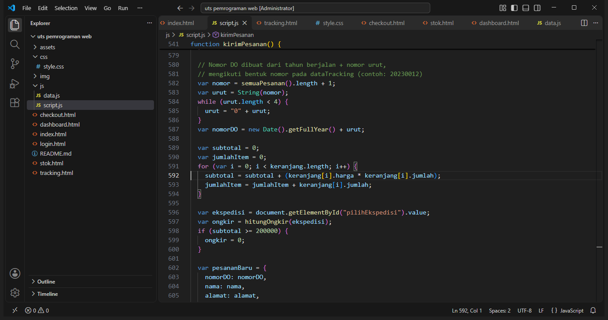

**Hasil di browser**

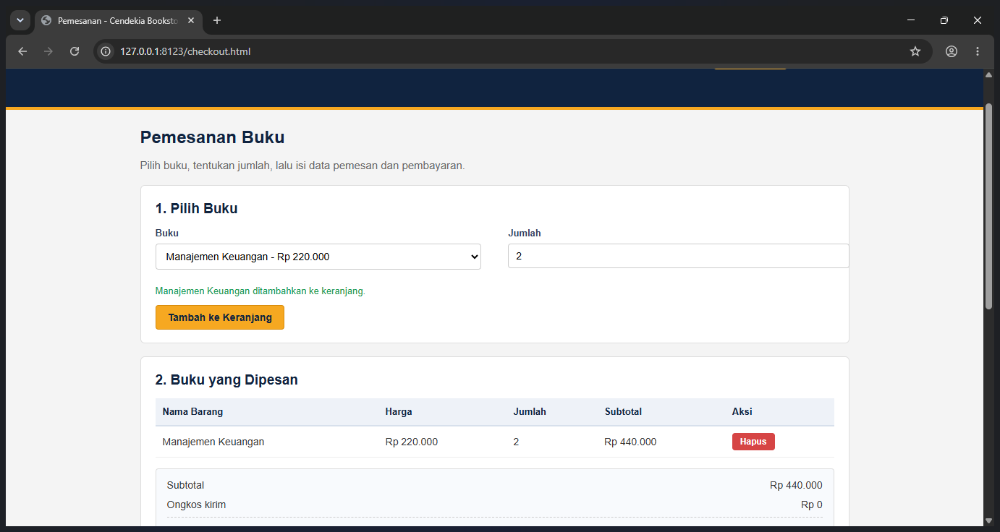

Pilihan buku di dropdown juga dibuat dari data, bukan ditulis manual. Buku yang stoknya 0 dilewati. Waktu ditambahkan ke keranjang, jumlahnya dicek dulu ke stok, kalau minta lebih dari stok yang ada muncul alert. Buku yang sama kalau ditambahkan dua kali tidak jadi baris baru, jumlahnya saja yang ditambah.

Total dihitung otomatis: subtotal dari harga dikali jumlah, ongkir sesuai ekspedisi (JNE Rp 15.000, Pos Indonesia Rp 18.000, SiCepat Rp 13.000), dan kalau belanja mencapai Rp 200.000 ongkirnya jadi gratis. Di contoh ini dua buku Manajemen Keuangan harganya Rp 440.000, jadi ongkirnya Rp 0.

**Hasil setelah tombol Buat Pesanan ditekan**

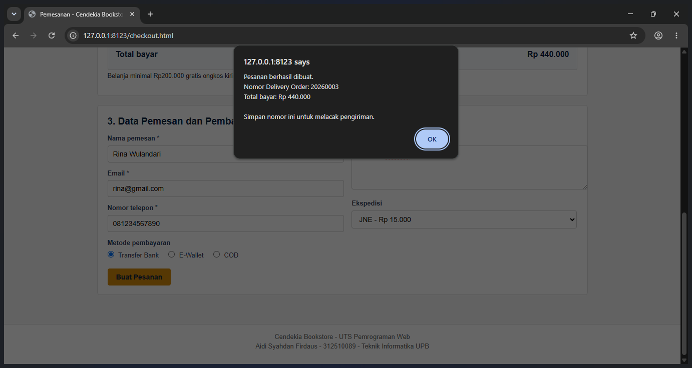

Sebelum pesanan dikirim, data pemesan divalidasi: nama, email, telepon, dan alamat tidak boleh kosong, email harus ada `@` dan titik, telepon minimal 10 angka, alamat minimal 10 karakter. Kalau semua lolos, nomor DO dibuat dari tahun berjalan ditambah nomor urut yang digenapkan jadi 4 digit, jadi bentuknya sama seperti nomor di data dosen (`20230012`). Nomornya ditampilkan lewat alert supaya pengguna sempat mencatat, lalu keranjang dan form dikosongkan lagi.

### 7. Halaman tracking: cari nomor DO, progress bar, dan riwayat

**tracking.html**

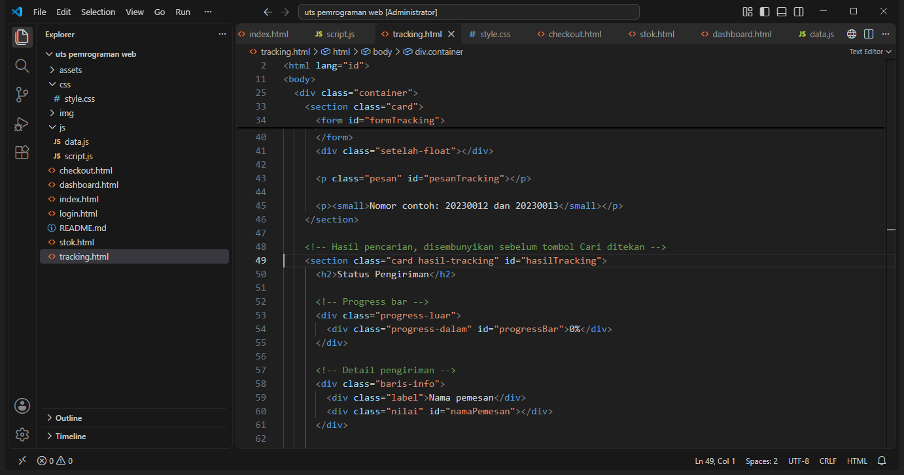

**js/script.js**

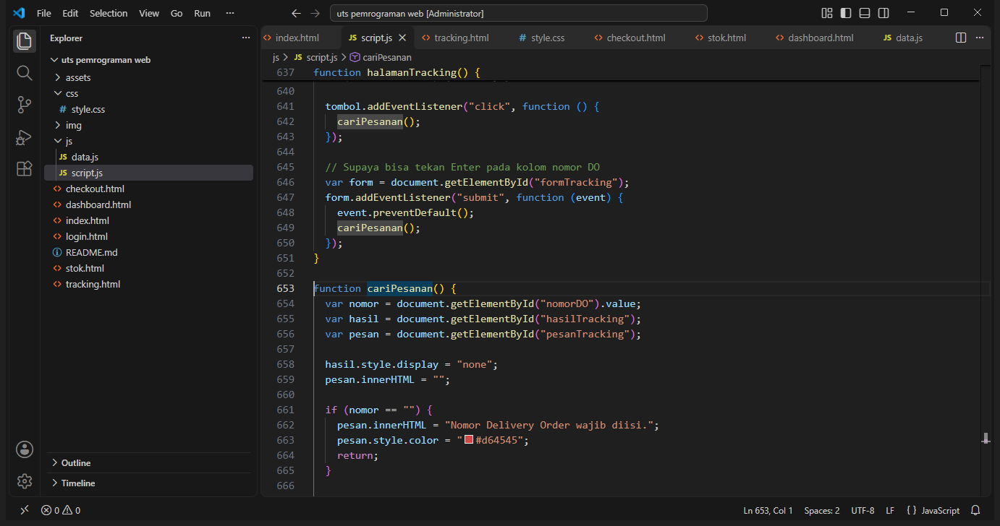

**Hasil di browser**

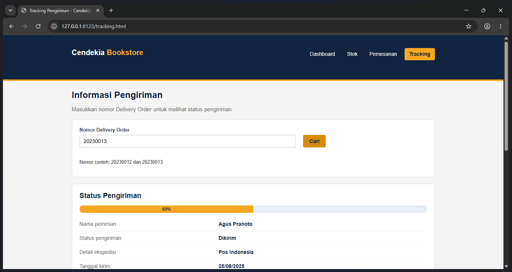

Panel hasil awalnya disembunyikan pakai `style="display: none"`. Waktu tombol Cari ditekan, nomornya dicari dulu ke `dataTracking`. Kalau tidak ada di situ, dicari lagi ke pesanan baru yang tersimpan dari halaman pemesanan, jadi nomor DO yang baru dibuat tetap bisa dilacak. Kalau memang tidak ketemu, muncul alert. Kalau ketemu, baru panelnya ditampilkan dengan `display = "block"`.

**Hasil di browser bagian riwayat perjalanan**

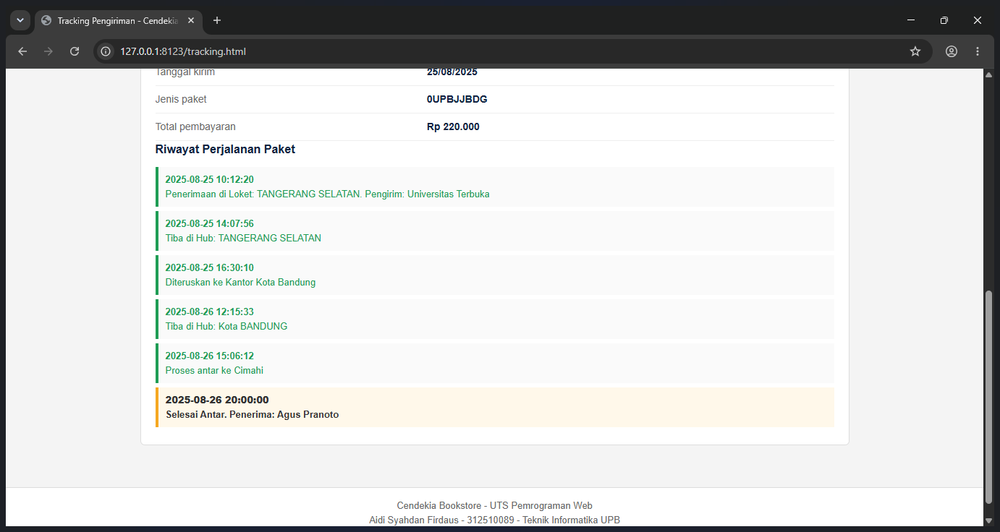

Progress bar dan riwayatnya juga dari data. Status diubah jadi persentase lewat fungsi `nilaiProgress()`: Diproses 25%, Dikirim 50%, Dalam Perjalanan 75%, Diterima 100%. Lebar bar-nya diatur dari JavaScript pakai `style.width`, ini contoh CSS inline. Daftar perjalanan diambil dari array `perjalanan` pada data, tiap langkah dibuat `<li>` baru, dan langkah terakhir dikasih class `aktif` biar warnanya beda sebagai posisi paket sekarang.

**Hasil kalau nomornya salah**

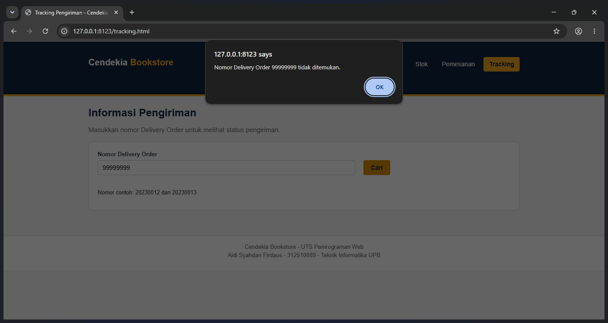

### 8. CSS tiga cara: eksternal, internal, dan inline

**css/style.css (CSS eksternal)**

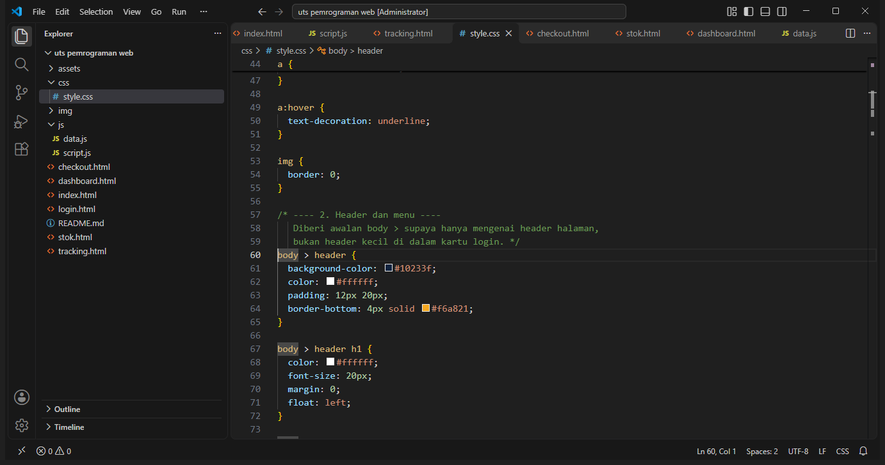

**js/script.js (CSS inline dari JavaScript)**

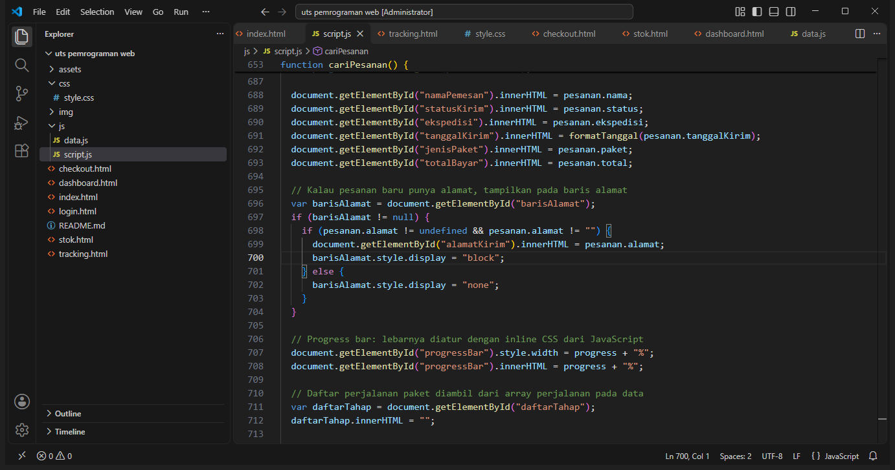

Sebagian besar gaya ada di `css/style.css` yang dipanggil kelima halaman, jadi sekali ubah langsung kepakai semua. Khusus halaman dashboard, ada satu blok `<style>` di dalam `dashboard.html` untuk gaya yang cuma dipakai di situ (kotak ringkasan laporan), ini contoh CSS internal. Yang terakhir CSS inline, ditulis langsung dari JavaScript waktu mengatur lebar progress bar dan menyembunyikan panel hasil tracking.

Satu hal yang sempat bikin tampilan login berantakan: aturan `header { ... }` di CSS itu selektor global, jadi ikut kena `<header>` kecil di dalam kartu login. Akibatnya kartu putihnya jadi punya pita navy di atas. Solusinya selektornya saya ubah jadi `body > header`, artinya cuma header yang anak langsung `<body>` yang kena. Header di dalam kartu login tidak lagi ketiban gaya itu.

---

## Struktur folder

```
uts pemrograman web/
├── index.html          halaman login
├── login.html          pengalih ke index.html
├── dashboard.html      menu utama, sapaan, laporan, histori
├── stok.html           informasi stok / katalog buku
├── checkout.html       halaman pemesanan
├── tracking.html       informasi pengiriman
├── css/
│   └── style.css       CSS eksternal untuk semua halaman
├── js/
│   ├── data.js         data dari dosen (pengguna, katalog, tracking)
│   └── script.js       JavaScript untuk semua halaman
├── assets/
│   └── logo.png
└── img/
    ├── pengantar_komunikasi.jpg
    ├── manajemen_keuangan.jpg
    ├── kepemimpinan.jpg
    ├── mikrobiologi.jpg
    └── paud_perkembangan.jpeg
```

---

## Cara menjalankan

1. Buka folder `uts pemrograman web`
2. Klik dua kali `index.html`, atau jalankan server lokal dengan `python -m http.server 8000` lalu buka `http://localhost:8000` di browser
3. Login pakai salah satu akun dari `data.js`:

   | Email | Password | Role |
   |---|---|---|
   | rina@gmail.com | rina123 | User |
   | agus@gmail.com | agus123 | User |
   | siti@gmail.com | siti123 | Admin |

4. Nomor Delivery Order yang bisa dicoba di halaman tracking: `20230012` dan `20230013`

---